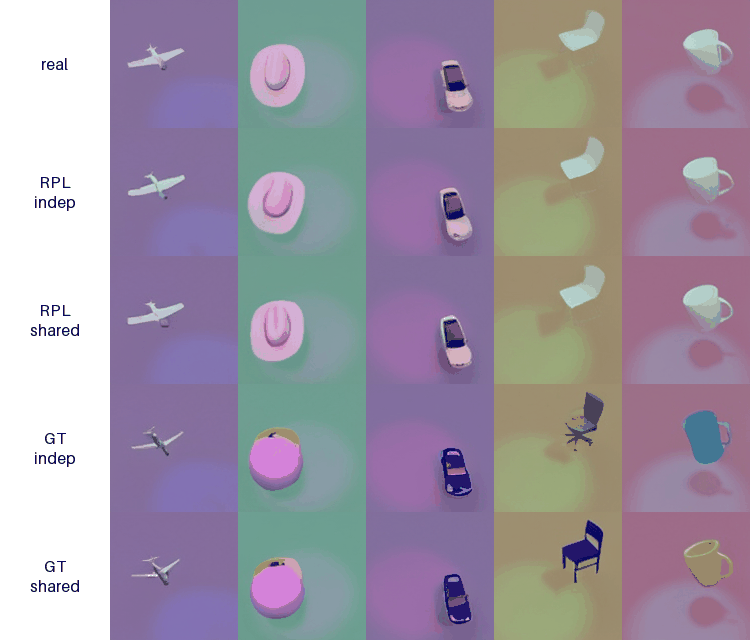
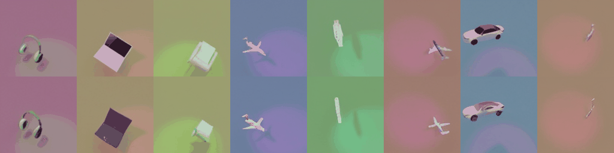

# 2026.11.25 -- RPL-conditioned frame diffusion on TLT12

## 1. Objectives

- Reproduce Friedemann's latent diffusion pipeline on TLT12 as the generative baseline.
- Test what the frozen RPL representation $c_t$ keeps about the scene. We train a diffusion model that generates a single frame $x_t$ from $c_t$, use it to generate whole sequences frame by frame, and check which properties stay the same over time.

## 2. Setup

- **Data:** TLT12, 128×128 frames, 32-frame sequences (train 96k, val 12k).
- **Generator:** frozen SD VAE (frames as 4×16×16 latents) + conditional UNet (66M), v-prediction, cosine schedule, 50-step DDIM, CFG $w=2$, 15% null-condition dropout, 80k steps at batch 512.
- **Representation:** released TLT12 RPL checkpoint (ResNet encoder → LSTM), frozen, in eval mode, 64×64 input. The condition is the LSTM output $c_t \in \mathbb{R}^{256}$, which has seen frames $0..t$.
- **Frame model, not clip model:** following Fabian's suggestion, the generator never learns anything about sequences. The clip model's temporal layers make frames consistent on their own,  we couldn't tell what comes from $c$. Here each frame is generated separately from its own $c_t$, so anything stable across frames must be encoded in $c_t$ (or with shared noise).
- **Baseline:** the same frame model conditioned on the true class + 10 GT factors, no object id.
- **Protocol:** 300 val sequences (25 per class), every frame generated from its own condition. Two noise settings, identical for both models:
  - **indep:** a new initial noise for every frame;
  - **shared:** one initial noise per sequence, reused for all 32 frames.

**Columns in Table 3** (read from every frame by a probe trained on real frames):

- **object_acc:** fraction of frames showing the true object (12 classes × 20 objects; chance ≈ 0.05 within the class).
- **consistency:** how stable the predicted object is over the 32 frames.
- **jerk:** smoothness of the probed factor trajectories (lower is smoother).
- **track_err:** mean absolute error between probed and true factors.

## 3. Results

### 3.1 Reproduction of the guide

| | 20k | 40k | 60k | 80k |
|:--|:--|:--|:--|:--|
| Frame FID, guide | 25.0 | 20.2 | 18.2 | 16.9 |
| Frame FID, ours | 24.33 | 19.69 | 18.01 | 16.88 |

The clip model (frame-mode FID 14.84 at 160k vs 15.3 in the guide) and the probe (class 0.996, object 0.991 on real val frames) also match. The pipeline is used unchanged below, only the condition differs.

### 3.2 Checking the extracted RPL representations

To train the diffusion model we need, for every frame, the $c_t$ and the VAE latent code of the same frame, so we extract $c$ ourselves together
with the latents. Before using it, we check that our extraction matches the official one.

We compared our $c$ with the representations from the official extraction script, both evaluated with the official linear-probe script (val split).

| | official script | official + eval() | ours, $c$ | ours, $z$ |
|:--|:--|:--|:--|:--|
| class | 0.874 | 0.914 | 0.922 | 0.951 |
| trans_x | 0.966 | 0.971 | 0.972 | 0.973 |
| floor_hue (sin) | 0.988 | 0.994 | 0.993 | 0.994 |
| Δ trans_x | 0.496 | 0.536 | 0.535 | −0.003 |
| Δ floor_hue (sin) | 0.384 | 0.412 | 0.408 | −0.008 |
| spot_phi (sin) | 0.256 | 0.283 | 0.472 | 0.503 |
| rot_z (sin) | 0.035 | 0.045 | 0.102 | 0.128 |

**Results:** with BatchNorm in eval mode, the official extraction and ours agree within 0.01 on class, factors and velocities, so our $c$ is correct. 

As expected, the encoder output $z$ carries no velocity, while $c$ does, but only for translation and floor hue. rot_x, rot_y, rotation velocity and light movement are not linearly decodable from either.

### 3.3 Frame-by-frame generation

**Figure 1:** Frame-by-frame generation, rows from top to bottom: real, RPL indep, RPL shared, GT indep, GT shared.

| setting | class_acc | object_acc | consistency | switches | jerk | track_err |
|:--|:--|:--|:--|:--|:--|:--|
| real | 0.9951 | 0.9913 | 0.9913 | 0.0000 | 0.1251 | 0.1618 |
| RPL indep | 0.9906 | 0.9658 | 0.9658 | 0.0167 | 0.1985 | 0.1950 |
| RPL shared | 0.9895 | 0.9647 | 0.9647 | 0.0167 | 0.1386 | 0.1961 |
| GT indep | 0.9947 | 0.0973 | 0.2591 | 0.7367 | 0.2530 | 0.1611 |
| GT shared | 0.9955 | 0.0982 | 0.4158 | 0.7467 | 0.1406 | 0.1607 |

*Table 3: probe metrics on 300 val sequences (RPL model at 80k steps).*

- **consistency:** fraction of frames showing the sequence's most frequent object.
- **switches:** fraction of sequences whose most frequent object differs between the first and second half.
- **jerk:** mean absolute second difference of the probed factor trajectories, lower is smoother.
- **track_err:** mean absolute error between the probed factors and the true factors of the same frame.

**Results:** from $c_t$ alone, 96.6% of generated frames show the correct object, against 9.7% for the GT condition. With independent noise the RPL model almost never switches objects (0.017), while the GT model switches in 74% of frame transitions.

**Figure 2:** GT-conditioned clip model, for comparison (top: real, bottom: generated).

With the same GT conditions, the clip model keeps one object for the whole sequence, but it is usually not the real object. The consistency comes from its temporal layers, not from the condition, which is why the frame model is used to test $c$.
