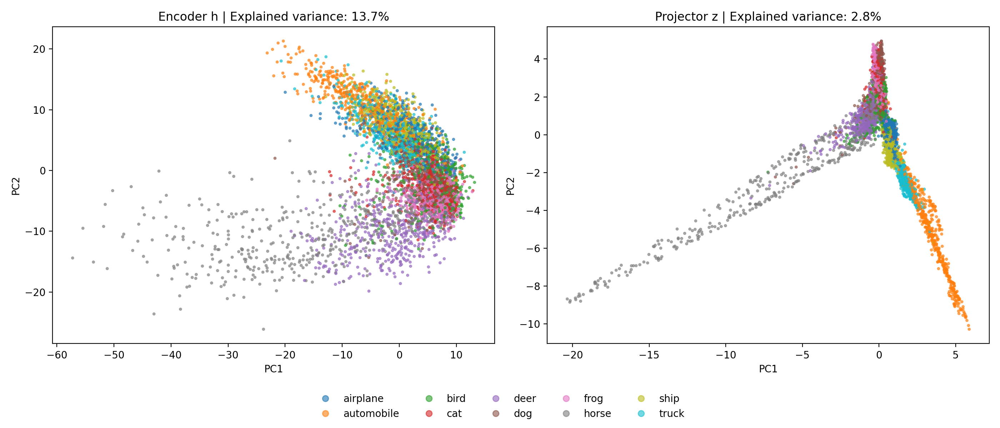
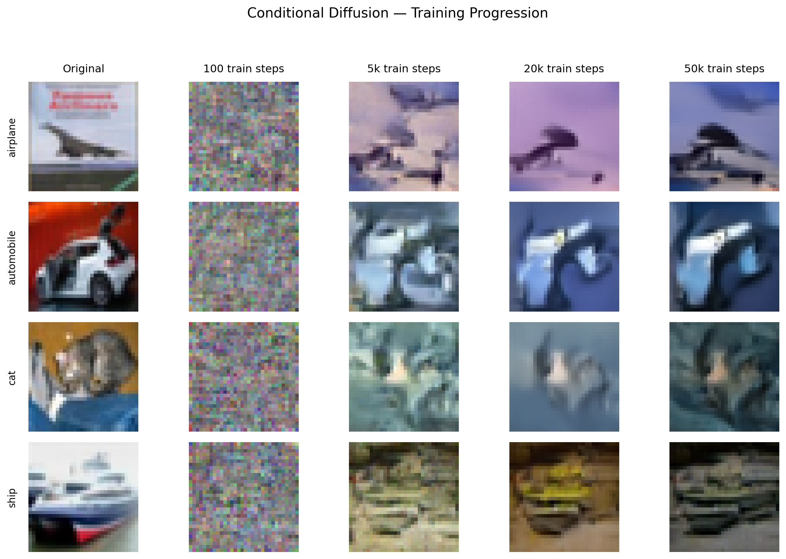
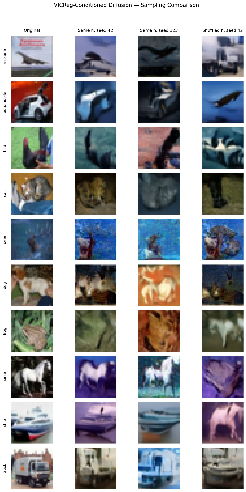
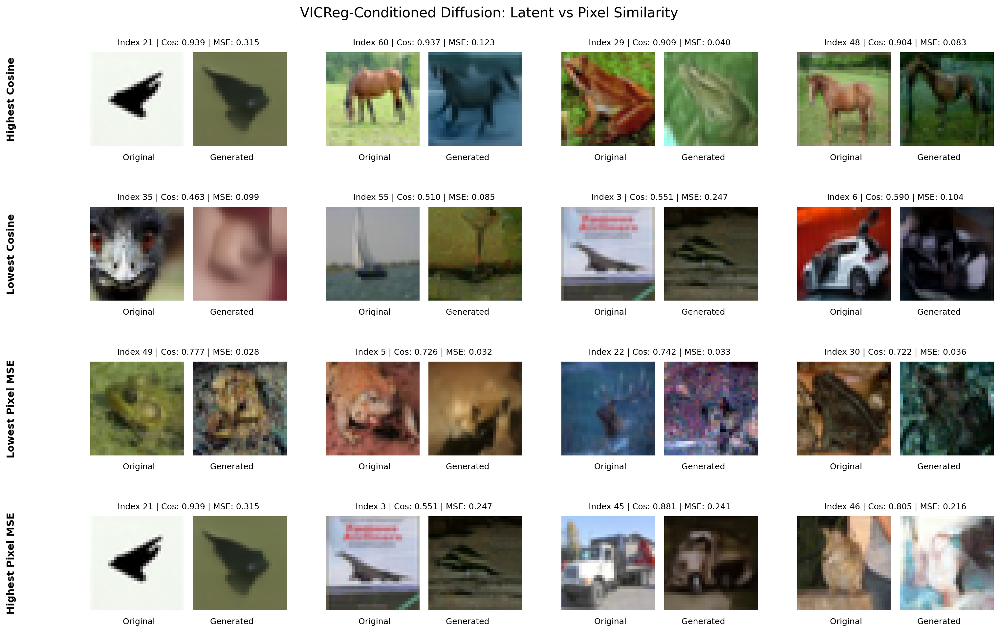

# VICReg-Conditioned Diffusion Decoder — Progress Update

## 1. VICReg Baseline

**Setup:** CIFAR-10; ResNet-18 encoder (512D);
MLP projector (1024D); VICReg objective;
500 epochs, batch size 64.

**Results:** Linear probing (frozen encoder):
**89.10% test accuracy**. PCA explained variance
(first two PCs): h = 13.7%, z = 2.8%.

## 2. Conditional Diffusion Decoder

**Setup**
- Frozen VICReg encoder; conditioning on 512D \(h\)
- Conditional U-Net: 10.33M parameters
- Conditioning: Linear projection → 4 × 128D tokens, cross-attention
- Pixel-space diffusion (32 × 32 RGB)
- DDPM: 1,000 timesteps, cosine noise schedule
- Training: AdamW, LR = 1e-4, batch size 8, 50k steps
- Sampling: DDIM, 50 / 100 steps, η = 0

**Results**
- 100 steps: mostly noise
- 5k steps: coarse colors and structures
- 20k steps: recognizable object structures
- 50k steps: further improvement, but samples remain blurry
- 50 vs. 100 DDIM steps: limited visual difference

### Figure 1: Generated samples across training checkpoints (100 / 5k / 20k / 50k):

### Figure 2: Original | Seed 1 | Seed 2 | Shuffled condition (50k checkpoint):
+ The two samples generated from the same VICReg embedding use different random seeds to examine how much the generated images vary while keeping the conditioning fixed.
 + The shuffled-condition samples use the same seed as the first sample but a different image's embedding, to examine how changing the conditioning affects generation.

## 3. Latent Cycle Consistency

**Objective**

Evaluate whether generated images preserve the original conditioning representation:

$$
z\sim q(z\mid x),\qquad
\hat{x}\sim p_\theta(x\mid z),\qquad
\hat{z}\sim q(z\mid\hat{x})
$$

Compare $ z $ and $ \hat{z} $ using cosine similarity and L2 distance.

**Setup**
- CIFAR-10 test set, 64 images
- Frozen VICReg encoder + 50k diffusion checkpoint
- DDIM 50 steps, fixed random seed
- Mismatched embeddings as negative references

**Results**

| Metric | Mean ± Std |
|---|---:|
| Cosine similarity (correct)  | **0.7683 ± 0.0996** |
| Cosine similarity (mismatched reference) | 0.3673 ± 0.1359 |
| Embedding L2 distance  | 21.37 ± 7.27 |
| Pixel MSE  | 0.1015 ± 0.0556 |

Original embedding sanity check: maximum absolute error ≈ 1.0e-5.

**Preliminary observation:** Generated samples show higher embedding similarity to their conditioning representations than to mismatched references.

**Figure 3:** Original vs. generated images with latent similarity scores:

## 4. Next Steps

1. **Reconstruction similarity across samples:** Generate multiple images from the same embedding using different random seeds, and evaluate their similarity to the original image.
2. **Nearest-neighbor comparison:** Compare the similarity between generated and original images against the similarity between the original images and their nearest neighbors in the training set.
3. **GT-latent control experiment:** Train a separate diffusion decoder conditioned on ground-truth latents from TLT12, as a control to investigate the causes of blurry reconstructions.

