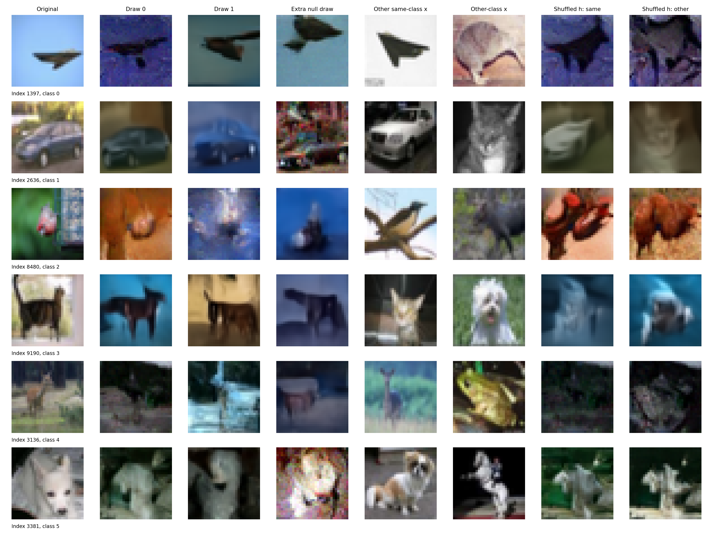
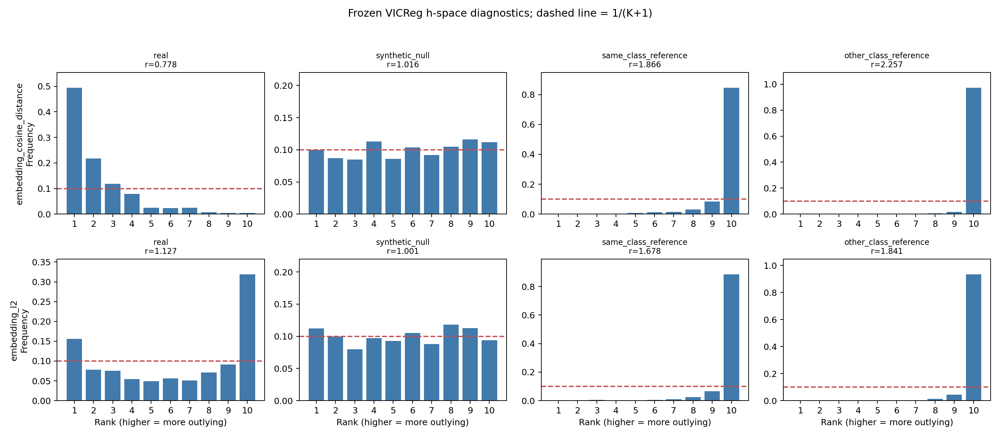
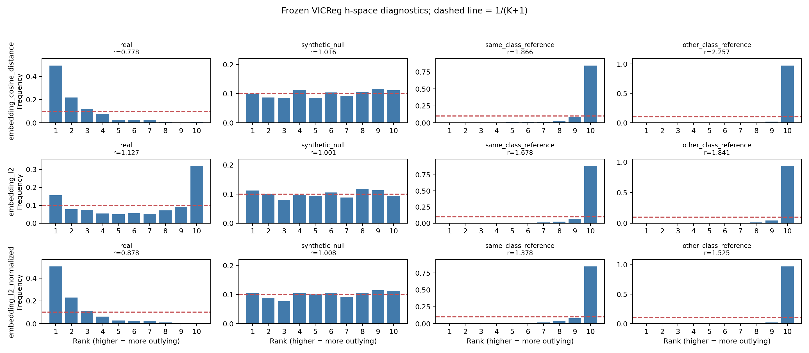
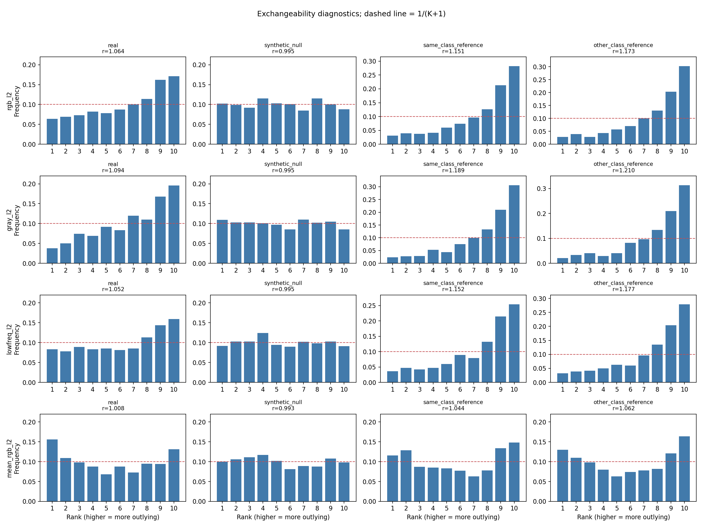

# 2026.11.11 --     Multiple-seed Reconstruction

## 1. Objectives:

- Assess whether the original-to-generated image difference is unusual relative to the variability among samples generated from the same embedding.
- Test whether generation uses image-specific conditioning information beyond class identity.

## 2. Setup:

- CIFAR-10 test set: 1,000 original images, 100 per class.  

- Frozen VICReg encoder trained for 500 epochs; conditioning on the 512-dimensional representation ($h=E(x)$).

- Frozen diffusion decoder trained for 50k steps.

- Sampling: DDIM, 50 steps, ($\eta$=0).

- For each original, generate 9 samples using independent initial noise seed and 1 additional sample for the synthetic-null control.

- Generate two shuffled-condition samples using another same-class or different-class image’s embedding, with the same initial noise as draw 0.

Let $\hat{x}_k=G(h,\epsilon_k)$, where $h=E(x)$.

**Columns in Figure 1**

- **original**: Original test image $x$.

- **draw0**: $\hat{x}_0$, generated from $h$ with initial noise $\epsilon_0$.

- **draw1**: $\hat{x}_1$, generated from the same $h$ with independent noise $\epsilon_1$.
 
- **Extra null draw**: $\hat{x}_9$, an additional independent sample from the same $h$.

- **Other same-class x**: Another real test image $x_s$ from the same class.

- **Other class x**: Another real test image $x_o$ from a different class.

- **Shuffled h: same**: $G(E(x_s),\epsilon_0)$: same noise as draw 0, but a same-class image’s embedding.

- **Shuffled h: other**: $G(E(x_o),\epsilon_0)$: same noise as draw 0, but a different-class image’s embedding.

**Figure 1:** Original images, repeated conditional samples, reference images, and matched-noise shuffled-condition samples.

## 3. Exchangeability evaluation

**3.1 Embedding Space evaluation**

Original and generated images are encoded using the same frozen VICReg encoder to obtain 512-dimensional embeddings. Two distances are evaluated separately: cosine distance (1 − cosine similarity) and Euclidean (L2) distance on the unnormalized embeddings. The same rank-based evaluation and synthetic-null controls are applied in embedding space.

For each original, compare the mean reference-to-sample distance $D_{xs}$ with the mean sample-to-sample distance $D_{ss}$. 

$r=\frac{\text{mean}_i D_{xs,i}}{\text{mean}_i D_{ss,i}}.$

Each reference is also ranked by its average distance to the other nine members; higher ranks indicate greater outlyingness.

The same nine generated samples are evaluated with four references:

- Real: the original image.

- Synthetic null: the additional same-embedding sample.

- Same-class reference: another same-class real image.

- Other-class reference: another different-class real image.

If the reference and generated samples are exchangeable, the reference should appear equally often at each rank. With ten images per group, it should be the most outlying image in about 10% of groups. 

We estimate uncertainty by repeatedly resampling whole image groups within each class. To test the distance difference, we randomly reassign the reference within each group and compare the results with the observed difference. 

**Figure 2**: Rank distributions in the frozen VICReg embedding space. 

Rows show cosine distance and L2 distance; columns show the four reference conditions. Each group contains one reference and nine generated samples. Rank 1 indicates the lowest average distance to the other members, and rank 10 the highest. The dashed line marks the expected frequency of 10% under exchangeability. Each panel also reports the distance ratio $r=\bar D_{xs}/\bar D_{ss}$.

**Results:** The real-reference results are summarized below. Distances are averaged over 1,000 original images and nine generated samples per image.

| Metric | Mean original-to-generated distance ($\bar{D}_{xs}$) | Mean generated-to-generated distance ($\bar{D}_{ss}$) | Ratio ($r$) (95% CI) | Reference at rank 10 |
| :--- | :---: | :---: | :---: | :---: |
| Cosine distance | 0.2284 | 0.2936 | 0.7777 [0.7712, 0.7841] | 0.5% |
| L2 distance | 21.7277 | 19.2819 | 1.1268 [1.1083, 1.1457] | 31.9% |

In cosine distance, original embeddings are more central than generated embeddings: their mean distance to the generated samples is 22.2% lower than the mean distance between generated samples. The mean original-to-generated cosine similarity is 0.7716. 

In contrast, L2 distance places original embeddings farther from the generated samples: the mean distance is 12.7% higher, and originals occupy rank 10 in 31.9% of groups, compared with the expected 10%. Both metrics show departures from exchangeability, with distance-difference and rank-uniformity tests remaining significant after Holm correction.

The synthetic-null control is close to the expected behavior in both L2 distance and cosine distance.

**Embedding norm comparison**: Generated embeddings have lower mean norms than original embeddings in all ten classes.

| Statistic | Value |
| :--- | :---: |
| Mean original embedding norm | 33.7545 |
| Mean generated embedding norm | 24.9248 |
| Mean paired difference (original – generated) | 8.8299 |
| Relative reduction in mean norm | 26.2% |

Generated embeddings have smaller norms than original embeddings, which may contribute to the different cosine and L2 results. 

After normalizing each embedding to unit length, the L2 distance ratio decreases from 1.127 to 0.878. The proportion of originals at rank 10 falls from 31.9% to 0.5%, matching the cosine result. This shows that embedding magnitude substantially affects the raw L2 outlyingness pattern. 

**Figure 3**: Comparison of exchangeability rank distributions using cosine distance, raw L2 distance, and L2 distance after unit normalization of embeddings.

However, normalization does not restore exchangeability: original embeddings are now more central than generated embeddings.

**3.2 Pixel Space evaluation**

Four distances are evaluated separately: RGB, grayscale, low-frequency RGB (8×8 average-pooled images), and mean RGB color. All use dimension-normalized Euclidean distance. 

**Figure 4**: Rank histograms for four distances and four reference conditions. The dashed line marks the uniform expectation of 10%.

Original images tend to be farther from the generated samples than the samples are from each other in RGB, grayscale, and low-frequency comparisons. Average colors show a distance ratio close to 1, but their ranks are still not uniform. Like the embedding-space results, these findings show that originals and generated samples are not fully exchangeable, although the direction of the difference depends on the distance used.
